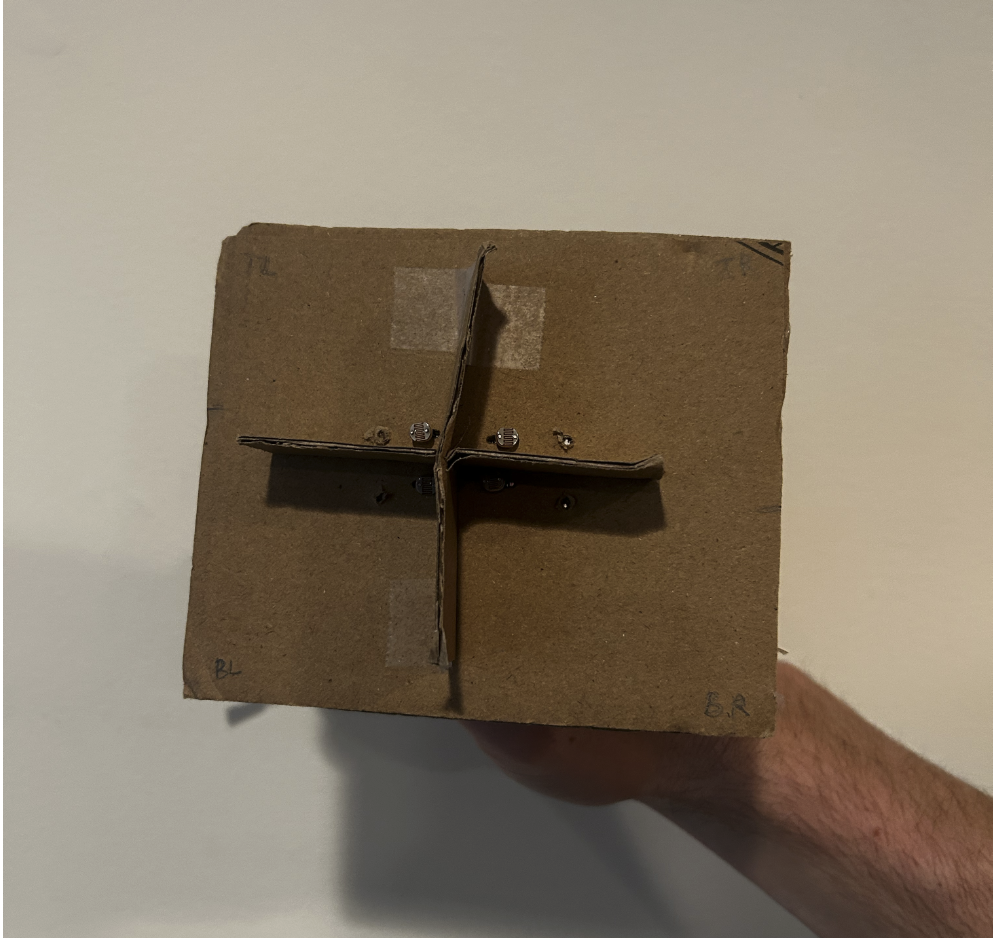

# Dual-Axis Solar Tracker

A Raspberry Pi tracker that points itself at the brightest light source. Four photocells sit in quadrants around a cross-shaped baffle. When the light is off-center, the baffle shades some of the cells, and the tracker turns toward the brighter side until the cells read evenly.

## How It Works

- An MCP3008 analog-to-digital converter reads the four photocells and sends the values to the Pi over SPI, since the Pi has no analog inputs.
- About 20 times a second, the loop averages the top, bottom, left, and right pairs and compares them:
  - If even the brightest cell is below the room's light level, the tracker sits idle.
  - If left and right differ by more than the threshold, it pans 4° toward the brighter side.
  - Otherwise, if top and bottom differ, it tilts 4°.
- A calibration step records the room's light for 30 seconds, so the tracker ignores ordinary room light.
- The `pigpio` service generates the servo pulses with hardware timing, so they stay accurate even when Python is busy.
- A Flask dashboard shows live sensor readings and servo angles, and switches between automatic tracking and manual control.

## Hardware

| Part | Connection |
|---|---|
| Raspberry Pi 4B | |
| MCP3008 analog-to-digital converter | SPI0: GPIO 8, 9, 10, 11 |
| 4 photocells in voltage dividers | MCP3008 channels 0–3 (top-left, top-right, bottom-left, bottom-right) |
| Pan servo, 20 kg | GPIO 17 |
| Tilt servo, 20 kg | GPIO 18 |
| 6 V supply | Powers the servos only. Ground shared with the Pi |

## Servo Head


## Schematic


## Running It

Enable SPI on the Pi (`sudo raspi-config` → Interface Options → SPI), then:

```bash
pip install flask markdown gpiozero pigpio
sudo pigpiod                 # start the servo timing service
python3 calibrate.py         # 30 seconds: tilts straight up and records room light
python3 app.py               # dashboard at http://<pi-address>:5001
```

## Files

| File | Purpose |
|---|---|
| `app.py` | Tracking loop and web dashboard |
| `calibrate.py` | Records room light to `room_calibration.csv` |
| `remote.py` | Manual servo control, for testing the servos on their own |
| `templates/` | Dashboard pages |

## Limitations and Next Steps

- Photocell readings aren't filtered. A moving average would smooth out noise.
- Python on Linux doesn't guarantee when the loop runs, though `pigpio` keeps the servo pulses themselves accurate.
- Fixed 4° steps limit how precisely it can center on the light.

These limits led to version 2, the [Pan-Tilt System](https://github.com/Alexgruden/PAN-TILT-SYSTEM), built on an STM32 with hardware-timed control.